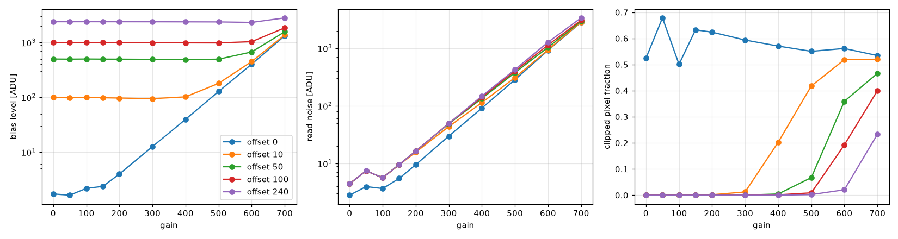
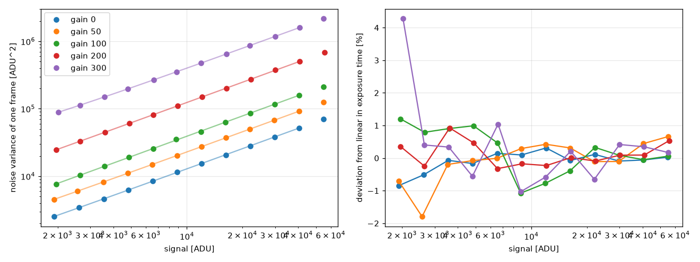
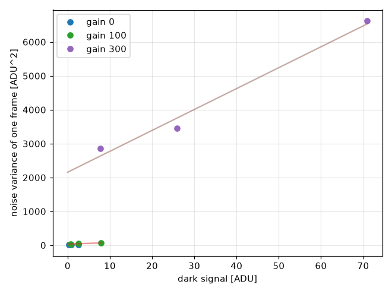
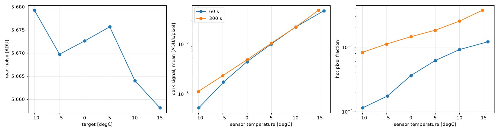

# ZWO ASI2600MM Pro

Notes from bringing up and characterizing an ASI2600MM Pro with pyobs-asi (November 2026). Statements are marked as
**measured** (own data, with the script or command given), **inferred** (conclusion from measurements, not verified) or
**from the SDK** (value reported by the driver).

## Setup used

- Host: Linux, camera on a USB 3.0 port directly on the mainboard (5000 Mb/s, checked with `lsusb -t`).
- SDK: official ZWO ASI Camera SDK 1.41, bundled in `sdk/` (see `sdk/license.txt`).
- pyobs-core 2.23.4, `zwoasi` from PyPI.
- udev rules from `sdk/asi.rules`, `usbfs_memory_mb` = 200.
- All noise numbers below are for a central 2048x2048 window, bin 1, 16 bit (RAW16), high speed mode off.

## Camera properties (from the SDK)

| Property | Value |
|---|---|
| Sensor size | 6248 x 4176 pixels, mono |
| Bit depth | 16 |
| Cooler | yes (`IsCoolerCam`), no mechanical shutter |
| Binning | 1, 2, 3, 4 |
| Exposure | 32 us to 2000 s |
| Gain | -25 to 700 (default 200) |
| Offset | 0 to 240 (default 1) |
| Bandwidth overload | 40 to 100 (default 50) |
| Other controls | HighSpeedMode, HardwareBin, AntiDewHeater, FanSpeedAdjust, Flip, PowerLedBright, UsbHubReset, auto exposure |
| `ElecPerADU` | 0.243 (read at camera open; it matches gain 100, where 0.255 e-/ADU was measured, see below) |

## Findings

**SDK version matters (measured).** The community copy of SDK 1.37 returned corrupt frames: with high speed mode off
the image was a flat ~58000 ADU or all zeros, with it on about 14% of the rows of a full frame were wrong. The
corruption was the same in every run of the same setting, independent of USB bandwidth setting and exposure time. With
the official SDK 1.41 full frames (6248x4176) are clean. Do not use 1.37 from third-party repositories.

**High speed mode (measured, partly inferred).** With SDK 1.41, off (the default) gives clean frames. On gives about 4
odd pixels per row (16713 per full frame), which I assume are edge columns (not checked). The readout of a full frame
was 0.71 s with it on and 0.86 s with it off (0.1 s exposure). The camera may keep the setting between runs, so
`asi-gui` sets it to 0 on startup.

**Exposure time (measured).** The SDK minimum is 32 us. `asi-gui` clamps the requested time to it, because 0 s gave
garbage frames and divided by zero in the progress timer.

**ROI alignment (from the SDK, zwoasi).** Width must be a multiple of 8 and height a multiple of 2. `asi-gui` rounds
down. With bins 2 to 4 the maximum window needs this too (3124 is not a multiple of 8).

**Binning (measured).** All four binnings work and come from `SupportedBins`. Bias noise per binned pixel falls
roughly like 1/bin (std 4.5, 2.3, 1.6, 1.2 ADU for bins 1 to 4), and the median stays at the same level. That looks like
averaging, not summing (inferred). `HardwareBin` (default off) was not tried.

**Temperature readout (measured).** The SDK returns 0.0 degC for a moment after the camera is opened. Wait for a
non-zero value.

**Kernel log (measured).** With the SDK a `usb 2-4: reset SuperSpeed USB device` message appears when the camera is
opened and several times during use, plus `did not claim interface 0 before use`. These are host-initiated resets
by the SDK, with no xhci or transfer errors, so I do not treat them as faults.

**USB 2.0 (measured).** Behind a USB 2.0 hub the camera links at 480 Mb/s and a full frame takes about 1.5 s or more
to read out. Use a USB 3 port.

## Offset and gain in the dark (measured, 25 degC)

One offset unit adds exactly 10 ADU to the bias (e.g. 500.3 ADU at offset 50, 2400.3 ADU at offset 240, gain 0). The
bias level is otherwise nearly independent of gain, as long as the pixels are not clipped at zero.



Bias level and read noise at offset 50 (from the difference of two bias frames, `bias` step of the script):

| Gain | Bias [ADU] | Read noise [ADU] | Clipped pixels |
|---|---|---|---|
| 0 | 500.3 | 4.46 | 0 |
| 50 | 497.8 | 7.44 | 0 |
| 100 | 500.6 | 5.66 | 0 |
| 150 | 498.2 | 9.58 | 0 |
| 200 | 497.0 | 16.33 | 0 |
| 300 | 493.5 | 48.74 | 0.05% |
| 400 | 488.2 | 134.2 | 0.5% |
| 500 | 496.9 | 375.9 | 6.7% |
| 600 | 673.6 | 1031 | 36% |
| 700 | 1575 | 2931 | 47% |

Fraction of clipped (zero) pixels vs gain and offset:

| Gain | Offset 0 | Offset 10 | Offset 50 | Offset 100 | Offset 240 |
|---|---|---|---|---|---|
| 0 | 0.524 | 0 | 0 | 0 | 0 |
| 50 | 0.679 | 0 | 0 | 0 | 0 |
| 100 | 0.501 | 0 | 0 | 0 | 0 |
| 150 | 0.633 | 0.0003 | 0 | 0 | 0 |
| 200 | 0.624 | 0.0017 | 0 | 0 | 0 |
| 300 | 0.594 | 0.0123 | 0.0005 | 0 | 0 |
| 400 | 0.571 | 0.203 | 0.0046 | 0.0014 | 0 |
| 500 | 0.551 | 0.418 | 0.067 | 0.0089 | 0.0023 |
| 600 | 0.562 | 0.519 | 0.359 | 0.193 | 0.0207 |
| 700 | 0.534 | 0.520 | 0.466 | 0.400 | 0.234 |

- Offset 0 clips about half of the pixels at every gain and should not be used.
- A good offset rises with gain. From the table: offset 10 is clean up to gain 200, offset 50 up to gain 300 and
  offset 240 up to gain 400.
- Where more than about 1% of the pixels are clipped the noise and mean are no longer reliable (the noise is too low,
  the mean too high). Ignore those entries.
- Read noise in ADU falls between gain 50 and 100 and then rises by about a factor 3 per 100 gain units. The gain
  steps are 0.1 dB per unit (confirmed by photon transfer, see below), and the drop at gain 100 is the HCG mode that
  ZWO lists for gain 100: it shows up as a drop of the read noise in electrons (3.3 to 1.4 e-), not as a step in e-/ADU.
- Dark signal at about 25 degC, gain 100, offset 50: +2.0 ADU after 10 s and +6.0 ADU after 30 s (median over the
  window, about 0.2 ADU/s). The cap was on, no light leak seen.

## Gain from a light source (measured)

Photon transfer with a roughly uniform, defocused wall lit by a steady lamp, sensor at 27 to 29 degC (cooler off), offset
50. Per gain 12 exposure times cover 3% to 85% of full scale, each with a pair of frames. The variance of the difference
of the two frames (central 512x512 pixels, lamp drift between the frames normalised) is fitted against the signal with
weights of 1/variance. The bias comes from the intercept of level vs exposure time, so no cap was needed.

| Gain | e-/ADU | ADU/e- | Slope error | Read noise [e-] (bias pairs) | Full scale [e-] |
|---|---|---|---|---|---|
| 0 | 0.783 | 1.277 | 0.3% | 3.5 | 50885 |
| 50 | 0.441 | 2.270 | 0.3% | 3.3 | 28632 |
| 100 | 0.255 | 3.914 | 0.5% | 1.4 | 16619 |
| 200 | 0.081 | 12.35 | 0.2% | 1.3 | 5263 |
| 300 | 0.026 | 39.08 | 0.2% | 1.3 | 1659 |



- The gain follows 0.1 dB per gain unit: the ratio is 0.56 from gain 0 to 50 (-5 dB) and 0.32 from 100 to 200 and 200 to
  300 (-10 dB). At gain 100 the line predicts 0.248 e-/ADU, measured 0.255.
- Gain 0 gives a full scale of 50.9 ke, which matches the 50 ke well depth on the ZWO page. The full scale in
  electrons at higher gain is set by the 16-bit ADC, not by the pixel.
- The read noise in electrons is the bias-pair noise (see the table above) times e-/ADU. The intercept of the photon
  transfer fit is not usable for it, because the lowest signal is 1900 ADU.
- Linearity in exposure time: the largest deviation is 0.8% to 1.8% at gains 0 to 200, mostly scatter of about 0.5%
  between points. Gain 300 at 0.49 ms is +4.3% (shutter timing or lamp flicker at short exposures, not separated).
  One pair at gain 100 had 3% lamp drift. The lamp and the wall were not characterised, so these are upper limits.
- Not verified here: the dependence on temperature, and the result for gains between the ones measured.

## Gain from the dark-current shot noise (cross-check, rough)

At 10 degC (cooler target 10) with the cap on, 30, 100 and 300 s exposures, offset 50. The slope of the frame variance
against the dark signal gives the gain in ADU per electron, but the dark signal is only 0.2 to 71 ADU.

| Gain | e-/ADU (dark) | Photon transfer | Ratio |
|---|---|---|---|
| 0 | 0.46 | 0.783 | 0.59 |
| 100 | 0.23 | 0.255 | 0.90 |
| 300 | 0.016 | 0.026 | 0.62 |

The estimate is off by up to a factor 1.7. With the MAD instead of the standard deviation the slopes change by 15% to
80%, so hot pixels and the small signal limit this method. Use the light source result.



Dark signal at 10 degC, gain 0: 0.23 ADU in 30 s and 2.6 ADU in 300 s (about 0.008 ADU/s). With 0.783 e-/ADU that is
about 0.007 e-/s per pixel. ZWO lists 0.0022 e/s/pixel at 0 degC (not verified); doubling every 6 degC (my assumption)
would give about 0.007 e/s at 10 degC, so the size agrees.

## Noise and dark current vs temperature (measured)

Cooler targets 15 to -10 degC in steps of 5 degC (setpoint moved by 1 degC every 30 s, 2 degC/min), gain 100, offset 50,
cap on. At each target a bias pair plus 60 s and 300 s dark pairs (central 2048x2048 window). Dark current is the mean
of the frames minus the mean of the bias frames, divided by the exposure time, in e-/s with 0.255 e-/ADU (gain 100).



| T [degC] | Cooler power | Read noise [ADU] | Dark 60 s [e-/s] | Dark 300 s [e-/s] | Hot pixels 60 s / 300 s |
|---|---|---|---|---|---|
| 15 | 1% | 5.66 | 0.0118 | 0.0120 | 0.0012 / 0.0037 |
| 10 | 10% | 5.66 | 0.0056 | 0.0056 | 0.0009 / 0.0025 |
| 5 | 24% | 5.68 | 0.0025 | 0.0026 | 0.0006 / 0.0018 |
| 0 | 37% | 5.67 | 0.0011 | 0.0012 | 0.0004 / 0.0015 |
| -5 | 53% | 5.67 | 0.0004 | 0.0006 | 0.0002 / 0.0011 |
| -10 | 70% | 5.68 | 0.00013 | 0.00028 | 0.0001 / 0.0008 |

Hot pixels are the fraction of pixels more than 20 sigma (bias MAD noise) above the median of the dark frame.

- Dark current doubles every 4.0 degC (60 s) to 4.6 degC (300 s) (exponential fit of the means, 15 to -10 degC).
- Read noise does not change with temperature (5.66 to 5.68 ADU).
- At 0 degC the dark current is 0.0011 to 0.0012 e-/s/pixel; ZWO lists 0.0022 e/s/pixel at 0 degC and 0.00012 at
  -20 degC (not verified, I do not know whether this is a mean or a median). Our extrapolation to -20 degC is about
  0.00006 e-/s (inference, not measured).
- Below 0 degC the 300 s value is 1.3 to 2 times the 60 s value (0.03 ADU after 60 s, 0.34 ADU after 300 s at -10
  degC). The cause is not known (hot pixel growth or a bias drift of 0.1 to 0.3 ADU between bias and dark frames are
  possible), so treat the values below 0 degC as upper limits.
- The median of the dark frame is not useful below 5 degC, because the median of integer values cannot resolve less
  than one ADU per frame. The report uses the mean.
- Cooling limit: at a setpoint of about -13 degC the cooler reached 95% power (a power rise of 14% to 17% per 5 degC,
  from 70% at -10 degC), about 35 degC below the ambient of about 22 degC. The 5 degC steps to -15 and -20 degC were
  not measured, the run was stopped by hand.
- The sensor temperature reading wobbles by about 1 degC when the cooler is idle near ambient (power 0 to 2%), so a
  target near ambient (20 degC) never settles. Use targets at least 5 degC below ambient.
- Reopening the camera switches the cooler off. A warm-up script after stopping a run must switch it on again at the
  current temperature before it ramps, otherwise the sensor warms up uncontrolled (12 degC in about 2 min seen here).

## Not done

Flat-field uniformity and dust, the gain between the measured gain values, the dependence of the gain on temperature,
and dark current below -10 degC (not reachable much further in this room).

## GUI (`asi-gui`)

- Gain and offset spinboxes (ranges from the camera), applied before every exposure.
- Cooler on/off, target, and a readout of sensor temperature and cooler power every 2 s.
- Default format INT16, exposure time clamped to the SDK minimum, window rounded to the SDK alignment.
- A failed exposure or an all-zero frame is not shown and no longer leaves the Expose button stuck.
- Not tested: switching the cooler on from the GUI (the cooler itself works, tested from the script).

## Reproduce

The script is `tools/characterize.py` (lens capped, no other program using the camera):

```bash
uv run python tools/characterize.py bias
uv run python tools/characterize.py gain
uv run python tools/characterize.py temperature
uv run python tools/characterize.py report
```

The `flat` step needs the lens uncapped, pointed at a steady, defocused light source:

```bash
uv run python tools/characterize.py flat
```

The `gain` step cools to `--target-temp` (default 20 degC; the run above used `--target-temp 10`), or use `--no-cooling`.

Results go to `characterization/<camera name>/` (JSON lines, a few 512x512 cutouts as FITS, plots and `report.md`).
