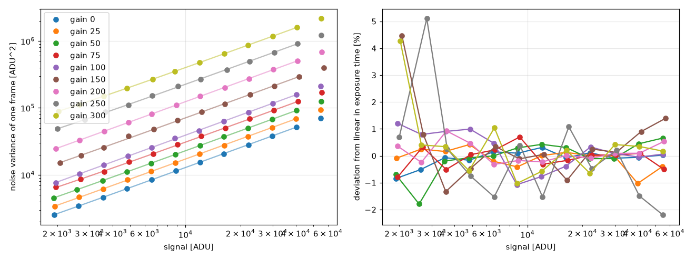
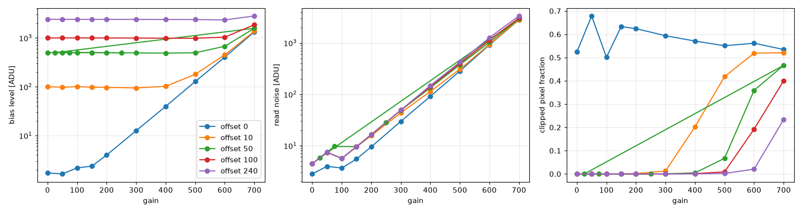
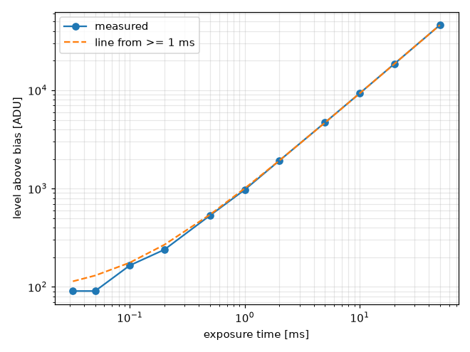
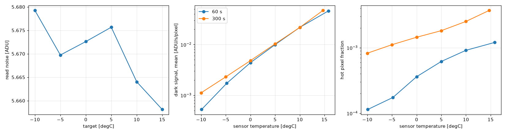
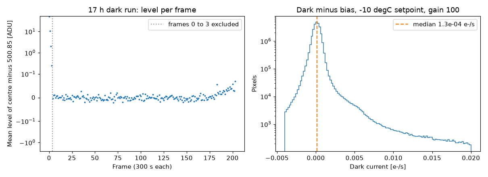

# ZWO ASI2600MM Pro, serial number 1d22d2002b020900

This report describes what was measured on one ZWO ASI2600MM Pro (monochrome, cooled CMOS camera) with pyobs-asi in
November 2026: gain, read noise, linearity, dark current, hot and noisy pixels, readout and cooling. Notes that apply
to every unit of the model (SDK, driver, recommended settings) are in the [model notes](../README.md).

Each statement is marked as **measured** (own data, linked below), **inferred** (a conclusion from the data that was not
checked separately) or **from the SDK** (a value the camera reports about itself). All numbers are for this unit.

## Summary

- **Gain** follows `0.783 * 10^(-gain/200)` e-/ADU to about 3% for gains 0 to 300, i.e. 0.1 dB per gain unit
  (measured). Gain 0 gives a full well of about 51 ke-, gain 100 gives 0.255 e-/ADU.
- **Read noise** is 3.3 e- up to gain 75 and 1.3 to 1.4 e- from gain 100 on, when the sensor switches to its high
  conversion gain mode (measured). The typical pixel is quieter (1.0 e- at gain 100); a tail of noisy pixels raises
  the average.
- **Dark current** halves every 4 to 4.6 °C of cooling. At -10 °C it is 1.3e-4 e-/s for the median pixel and 2.8e-4
  e-/s on average (17 h dark, measured). There is no amp glow.
- **Hot pixels:** about 0.1% of the pixels have more than 0.04 e-/s at -10 °C. They are stable over 17 h.
- **Salt-and-pepper noise:** about 1% of the pixels have more than five times the typical noise from frame to frame
  (random telegraph noise). Cooling does not remove it, and neither do bias or dark frames.
- **Linearity:** within 0.03% up to 70% of full scale for exposures from 1 ms on. Below a few ms the camera
  collects about 90 µs more light than set.
- **Readout:** 0.56 s per full frame, independent of binning. High speed mode is faster but adds 70% read noise.
- **Cooling:** about 35 °C below ambient at full power. The sensor can overshoot the setpoint by 2 °C while settling.

## Setup

- Linux host, camera on a USB 3.0 port of the mainboard (5 Gb/s). Behind a USB 2.0 hub a full frame takes 1.5 s or
  more to read out.
- Official ZWO ASI Camera SDK 1.41, bundled in `sdk/`. `zwoasi` from PyPI, pyobs-core 2.23.4 to 2.27.1, udev rules
  from `sdk/asi.rules`, `usbfs_memory_mb` = 200.
- Unless stated otherwise: 16 bit (RAW16), binning 1, high speed mode off, a central 2048x2048 window for the noise
  numbers, lens capped for dark measurements.
- Most measurements were made with `tools/characterize.py` (see [Reproduce](../../README.md#reproduce)); the 17 h
  dark was taken with `asi-gui`.
- Camera properties as reported by the SDK: [meta.json](meta.json), summarised in the
  [model notes](../README.md#camera-properties).

## Gain, read noise and full well (measured)

Photon transfer with a defocused, evenly lit wall and a steady lamp, sensor at 27 to 29 °C (cooler off), offset 50.
For each gain, pairs of frames at 12 exposure times cover 3% to 85% of full scale. The variance of the difference of
each pair (central 512x512 pixels, corrected for lamp drift) is fitted against the signal. The read noise comes from
pairs of bias frames. Data: [flat.csv](flat.csv) (photon transfer),
[bias.csv](bias.csv) (bias pairs).

| Gain | e-/ADU | Fit error | Read noise [e-] | Full scale [e-] |
|---|---|---|---|---|
| 0 | 0.783 | 0.3% | 3.5 | 50885 |
| 25 | 0.584 | 0.5% | 3.4 | 37981 |
| 50 | 0.441 | 0.3% | 3.3 | 28632 |
| 75 | 0.330 | 0.7% | 3.2 | 21461 |
| 100 | 0.255 | 0.5% | 1.4 | 16619 |
| 150 | 0.142 | 1.2% | 1.4 | 9258 |
| 200 | 0.081 | 0.2% | 1.3 | 5263 |
| 250 | 0.045 | 0.8% | 1.3 | 2936 |
| 300 | 0.026 | 0.2% | 1.3 | 1659 |

- The gain falls by 0.1 dB per gain unit: 5 dB from gain 0 to 50, 10 dB from 100 to 200 and from 200 to 300. The law
  `0.783 * 10^(-gain/200)` e-/ADU fits all nine gains within 3%. At 150 and 250 the deviation (+2.2% and +2.7%) is two
  to three times the fit error, possibly from the larger nonlinearity of those runs (inferred).
- The read noise drops from 3.2 e- at gain 75 to 1.4 e- at gain 100. That is the high conversion gain (HCG) mode ZWO
  lists for gain 100. It shows in the read noise, not as a step in e-/ADU. Where exactly between 75 and 100 the switch
  happens was not measured.
- At gain 0 the full scale of 50.9 ke- matches the 50 ke- full well ZWO quotes. At higher gains the 16-bit ADC, not
  the pixel, sets the full scale.
- The full scale at gains 25, 75, 150 and 250 uses a bias from the fit intercept, so it is good to about 1%.
- The dependence of the gain on temperature was not measured.

A rough cross-check from the shot noise of the dark current (10 °C, 30 to 300 s, cap on) gave gains 10% to 40% lower
than photon transfer, because the dark signal is small and hot pixels dominate the variance. Use the photon transfer
values. Data: [gain.csv](gain.csv), plot:
[ASI2600MM_Pro_gain.png](images/gain.png).

## Offset, bias level and clipping (measured)

Bias frames at gains 0 to 700 and offsets 0 to 240, at about 25 °C. Data, including the fraction of pixels clipped at
zero: [bias.csv](bias.csv).

- One offset unit adds 10 ADU. The bias is about 500 ADU at offset 50 and barely depends on the gain while no pixels
  are clipped.
- Offset 0 clips about half of the pixels at every gain.
- Lowest clean offset: 10 up to gain 200, 50 up to gain 300, 240 up to gain 400. Above about 1% clipped pixels the
  mean and the noise are no longer reliable.
- The read noise in ADU rises by about a factor of 3 per 100 gain units above gain 100 (5.66 ADU at gain 100, 48.7 at
  gain 300).

## Linearity and short exposures (measured)

The photon transfer runs give the linearity in exposure time: within 0.8% to 1.8% at gains 0 to 200, mostly scatter
of the lamp. Short exposures were measured separately at gain 100, sensor at 28 °C, with a 25 ms reference exposure
between the points to correct lamp drift. Data: [short.csv](short.csv),
[flat.csv](flat.csv).

- From 1 ms to 50 ms the level is a straight line; at 50 ms (70% of full scale) it is within 0.03% of the line.
- The line crosses the bias at -92 µs: every exposure collects about 90 µs more light than set. That is 9% at 1 ms
  and 90% at 100 µs.
- 32 µs and 50 µs give the same level, as if the shortest real exposure were about 100 µs (inferred from these
  points).
- This offset explains the 4% to 5% nonlinearity at the shortest exposures (0.4 to 0.7 ms) in the photon transfer
  runs (inferred). A bias taken from the intercept of level against exposure time is wrong by the count rate times
  92 µs.
- Not checked: whether the offset depends on gain, temperature or window size.

## Dark current vs temperature (measured)

Cooler targets from 15 °C down to -10 °C in steps of 5 °C, gain 100, offset 50, cap on. At each target a pair of bias
frames and pairs of 60 s and 300 s darks. Dark current is the mean of the dark minus the mean of the bias, converted
with 0.255 e-/ADU. Data: [temperature.csv](temperature.csv), temperature log of all
runs: [templog.csv](templog.csv).

- The dark current halves every 4.0 °C (60 s darks) to 4.6 °C (300 s darks) of cooling. It is 0.012 e-/s at 15 °C,
  0.0012 e-/s at 0 °C and 0.00028 e-/s at -10 °C (300 s).
- ZWO quotes 0.0022 e-/s at 0 °C and 0.00012 e-/s at -20 °C (not verified, unclear whether mean or median).
- The read noise does not change with temperature (5.66 to 5.68 ADU at gain 100).
- The bias level rises by only 0.11 ADU from 16 °C to -10 °C.
- Below 0 °C the 60 s darks give 1.3 to 2 times less than the 300 s darks. The 17 h dark below agrees with the 300 s
  values, so the 60 s values are the less reliable ones (inferred; the cause is unknown).
- A single full-frame 300 s dark at 10 °C gives 0.0051 e-/s on average, in line with 0.0056 e-/s from the central
  window, and its 8x8 block medians agree to 0.4 ADU: no amp glow.

## Long dark at -10 °C (measured)

The most sensitive dark-current measurement: 204 frames of 300 s (17 h) at a setpoint of -10 °C, gain 100, offset 50,
cap on, taken overnight with `asi-gui`, and 140 bias frames (minimum exposure) taken right after with the same
settings. Frames 4 to 203 were averaged into a master dark, all bias frames into a master bias.

Data: per-frame levels [dark_long_frames.csv](dark_long_frames.csv), bias frames
with temperatures [bias_long_frames.csv](bias_long_frames.csv), results
[dark_long_stats.csv](dark_long_stats.csv), hot pixel list
[hotpixels_-10C.csv](hotpixels_-10C.csv). The master frames (100 MB each) are not
in the repository.

- **Dark current:** the master dark minus the master bias has a median of 0.15 ADU after 300 s, i.e. 1.3e-4 e-/s per
  pixel. The mean (pixels above 1000 ADU excluded) is 2.8e-4 e-/s, the same as the 300 s value of the temperature
  series. 90% of the pixels are below 7e-4 e-/s, 99% below 2.1e-3 e-/s.
- **No amp glow:** the medians of an 8x8 grid of blocks range from 0.13 to 0.20 ADU.
- **Hot pixels:** 28088 pixels (0.11%) are more than 50 ADU (0.04 e-/s) above the bias, 16586 (0.06%) more than 100
  ADU, 37 more than 1000 ADU, and 2 are saturated. They are isolated pixels, not clusters or columns.
- **Stable over the night:** of the pixels more than 100 ADU above the bias, 0.3% changed by more than 20% between
  the first and the second half of the run.
- **Row pattern:** in the bias, odd rows are 0.40 ADU higher than even rows. In the dark minus bias the difference is
  0.01 ADU, so a bias subtraction removes it.
- **Noisy pixels:** the median temporal noise of a pixel in the 300 s darks is 4.06 ADU, and 1.1% of the pixels have
  more than five times that. This includes the shot noise of the hot pixels, so it is not directly comparable with
  the bias measurement in the next section.
- **First frames:** the first three frames of the run were 50, 11 and 2 ADU above the rest, the fourth 0.25 ADU. They
  are excluded. The cause is not known (inferred: leftover charge or a sensor not yet at temperature).
- **Slow rise at the end:** in the last 2 h of the run (from about 07:50 local time) the level rose by up to 0.05 ADU.
  This is too small to matter for the master dark. The cause is not known (inferred: the room warming up in the
  morning).
- **Caveat:** `asi-gui` did not write the sensor temperature into the dark frames at the time. During a later
  cool-down to the same setpoint the sensor went to -12.3 °C before it settled (see [Cooling](#cooling-measured)), so
  parts of the dark may have been colder than -10 °C. The agreement with the 300 s value of the temperature series
  suggests it was close to -10 °C (inferred). The bias frames were taken at -10.1 to -9.4 °C.

## Salt-and-pepper noise (measured)

CMOS sensors have pixels whose level jumps between two or more values from frame to frame (random telegraph noise).
In single frames they look like salt and pepper. To measure them, 60 full-frame bias frames were taken at 29.6 °C
(cooler off) and at -5.6 °C, at gain 100 and offset 50, and the temporal noise of every pixel was computed. Data:
[pixels.csv](pixels.csv).

- The typical pixel has 4.0 to 4.3 ADU (1.0 to 1.1 e-) of noise. The commonly quoted read noise (5.66 ADU, 1.4 e-) is
  the rms over all pixels, raised by the noisy tail.
- 0.7% (warm) and 1.0% (cold) of the pixels have more than five times the typical noise (above about 20 ADU or 5 e-).
  About 10% of these sit cleanly on two levels; the others switch too fast or too rarely to be separated in 60
  frames.
- Cooling does not help: the noisy fraction was slightly higher at -5.6 °C.
- The salt-and-pepper part is temporal, so a master bias or dark does not remove it. Only 1000 to 2700 pixels have a
  mean more than 20 ADU off the median. Dithering with sigma-clipped or median stacking should remove it (inferred, not
  tested).
- Not checked: dependence on gain, offset and exposure time, and whether the same pixels are noisy every night.

## Other fixed patterns (measured)

From 41 central 512x512 cutouts of bias, dark and flat frames, and from full frames:

- No correlated noise between neighbouring pixels (correlation below 0.03).
- Row means scatter 1.6 to 1.8 times more than white noise would give: a small row banding of about 0.3 ADU at gain
  100 (estimate).
- Odd rows are higher than even rows: 0.24 ADU at gain 0, 0.40 to 0.45 ADU at gain 100, growing with gain. Columns
  show no such pattern. In flats the rows differ by about 0.04%.
- The four quadrants of a bias frame differ by 0.06 ADU at gain 100.

## Readout and binning (measured)

Full frames at minimum exposure, gain 100, offset 50, all binnings, both speed modes, 16 and 8 bit. Data:
[readout.csv](readout.csv).

- A full frame takes 0.558 s from the start of the exposure until it is ready, plus 0.02 to 0.08 s for the download.
- The frame time does not depend on the binning (0.557 to 0.561 s): the sensor is always read out in full, binning
  only saves data (inferred).
- The binned pixels are averages, not sums: the noise falls like 1/bin (5.66, 2.87 and 1.46 ADU for bins 1, 2 and 4)
  and the bias level stays the same (inferred). `HardwareBin` was not tried.
- High speed mode cuts the frame time to 0.426 s (16 bit) or 0.361 s (8 bit), but raises the read noise by 70% (9.64
  instead of 5.66 ADU).
- In 8 bit mode the noise is just rounding.

## Cooling (measured)

- Cooling limit: at about 22 °C ambient the cooler needs 70% power for -10 °C and 95% for about -13 °C, i.e. about
  35 °C below ambient. At 28 °C ambient -20 °C is out of reach.
- Settling: after a cool-down to -10 °C the sensor went on to -12.3 °C at 89% to 97% power, and about 3 minutes later
  it was back at -10.1 to -9.4 °C at 70% to 78% power (frame headers, the settled part in
  [bias_long_frames.csv](bias_long_frames.csv)).
- With the cooler switched off a cold sensor warms up by about 14 °C per minute (0 to 8 °C in 35 s). pyobs-asi
  therefore ramps the setpoint by 1 °C every 30 s (2 °C/min) to 15 °C before it switches the cooler off.
- Near ambient (cooler power 0 to 2%) the temperature reading wobbles by about 1 °C and never settles.
- Opening the camera switches the cooler off, and the SDK reports 0.0 °C for a moment after opening.

## Not done and open questions

- Flat-field uniformity and dust.
- Gain vs temperature, and the exposure offset at other gains and temperatures.
- The exact gain where the high conversion gain mode switches on (between 75 and 100).
- A map of the noisy pixels and whether they stay the same from night to night.
- Dark current below -10 °C (not reachable at our room temperature).
- The cause of the warm first frames and of the slow rise at the end of the long dark.
- In one `asi-gui` session the first frames took 10 to 14 s from start to saved file instead of 2 s; the cause is
  unknown and it did not happen again.

## Data files

All in this folder. The `.jsonl` files are the raw records written by `tools/characterize.py`; the `.csv` files with
the same name hold the same data as tables, with a `utc` column added.

| File | Content |
|---|---|
| [bias.csv](bias.csv) | bias level, noise and clipping for each gain and offset |
| [flat.csv](flat.csv) | photon transfer: signal, variance and nonlinearity per exposure |
| [short.csv](short.csv) | level vs exposure time from 32 µs to 50 ms |
| [gain.csv](gain.csv) | dark shot noise cross-check at 10 °C |
| [temperature.csv](temperature.csv) | dark current, read noise and hot pixels per temperature |
| [templog.csv](templog.csv) | sensor temperature and cooler power of all runs, including stopped ones |
| [pixels.csv](pixels.csv) | per-pixel noise statistics, salt-and-pepper noise |
| [readout.csv](readout.csv) | frame and download times, noise per mode and binning |
| [dark_long_frames.csv](dark_long_frames.csv) | level of each frame of the 17 h dark |
| [bias_long_frames.csv](bias_long_frames.csv) | the 140 bias frames with temperature and cooler power |
| [dark_long_stats.csv](dark_long_stats.csv) | results of the 17 h dark |
| [hotpixels_-10C.csv](hotpixels_-10C.csv) | pixels more than 50 ADU above the bias after 300 s at -10 °C: position (x = column, y = row, from 0), excess, dark current, temporal noise |
| [meta.json](meta.json) | camera properties and controls as reported by the SDK |

